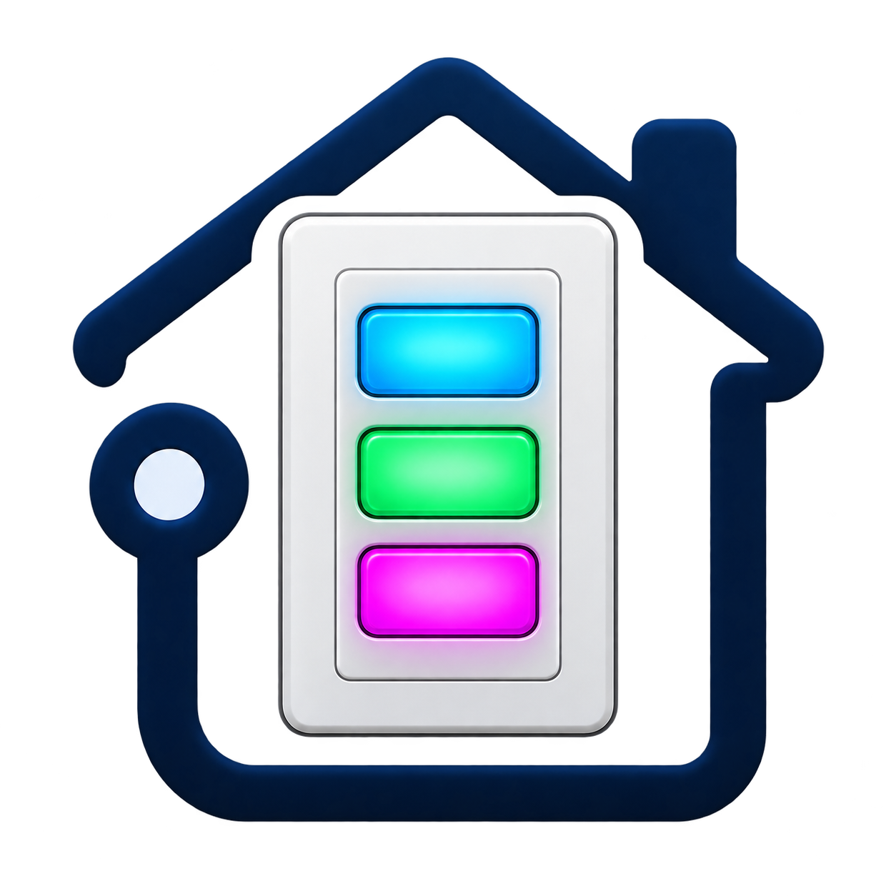
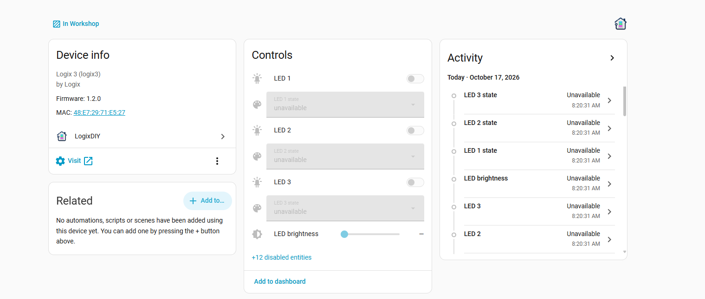

<p align="center">
  
</p>

<h1 align="center">LogixDIY for Home Assistant</h1>

<p align="center">
  A Home Assistant integration for Logix devices. It finds them on your network, then gives you their buttons, LEDs and settings as entities and automation triggers.
</p>

## Supported devices

| Device | Model ID | Firmware |
|---|---|---|
| Logix 3: three-button RGB scene controller | `logix3` | [logix3-firmware](https://github.com/logichousepcb/logix3-firmware) 1.2.0 or later (API version 1) |
| Logix Vent: motorised vent controller | `logixvent` | [vent-controller-firmware](https://github.com/logichousepcb/vent-controller-firmware) 1.2.0 or later (API version 1) |
| Logix Outlet: Gosund WO1 in-wall duplex receptacle with energy monitoring | `logixoutlet` | [logix-outlet-firmware](https://github.com/logichousepcb/logix-outlet-firmware) 1.0.0 or later (API version 1) |
| Logix Plug: Geekbes YM-WS-1 plug-in smart plug | `logixplug` | [logix-plug-firmware](https://github.com/logichousepcb/logix-plug-firmware) 1.0.0 or later (API version 1) |
| Logix RGB Plug: plug-in smart plug with an RGB night light | `logixrgbplug` | [logix-rgb-plug-firmware](https://github.com/logichousepcb/logix-rgb-plug-firmware) 1.0.0 or later (API version 1) |
| Logix GR: garage door relay with a button, RGB LED and temperature sensor | `logixgr` | [logix-gr-firmware](https://github.com/logichousepcb/logix-gr-firmware) 1.0.0 or later (API version 1) |
| Logix RGB Switch: KAUF SRF10 in-wall RGB light switch | `logixrgbswitch` | [logix-rgb-switch-firmware](https://github.com/logichousepcb/logix-rgb-switch-firmware) 1.0.0 or later (API version 1) |

See **[DEVICES.md](DEVICES.md)** for each device's requirements, entities and known limitations. More Logix devices will be added over time.

## Installation

### HACS

1. In HACS, open the menu (⋮) → **Custom repositories**.
2. Add `https://github.com/logichousepcb/LogixDIY` with type **Integration**.
3. Install **LogixDIY** and restart Home Assistant.

### Manual

Copy `custom_components/logixdiy` into the `custom_components` folder of your Home Assistant configuration directory, then restart Home Assistant.

## Setup

Devices are found automatically in two ways:

- **mDNS:** each device advertises `_logix._tcp`. It appears under **Settings → Devices & services → Discovered**.
- **MQTT:** if the device and Home Assistant share a broker, its retained `logix/discovery/<id>` message also triggers discovery.

To add one by hand, go to **Add integration → LogixDIY** and enter its IP address or hostname (e.g. `esp12f-e527.local`).

If the device has an admin password, you are asked for it. If you change the password later, Home Assistant asks for the new one.

## What you get (Logix 3)

<p align="center">
  
</p>

| Entity | Count | Description |
|---|---|---|
| `event.<device>_button_N` | 3 | Fires `single`, `double`, `triple` or `hold` for every completed button action |
| `light.<device>_led_N` | 3 | RGB LED. On means it shows one of its action colors. The **effect** chooses which one, and changing the color edits that slot. Brightness is shared by all three LEDs. |
| `select.<device>_led_N_state` | 3 | `off`, `single`, `double`, `triple` or `hold`. Setting it never toggles. |
| `number.<device>_led_brightness` | 1 | Brightness of all LEDs, 0-100 % |
| `button.<device>_button_N_<action>` | 12 | Simulates a press, exactly like the physical button. **Disabled by default.** |
| `button.<device>_restart` | 1 | Restarts the device |
| `sensor.<device>_wi_fi_signal` | 1 | Wi-Fi RSSI (diagnostic) |
| `sensor.<device>_ip_address` | 1 | IP address (diagnostic, disabled by default) |

### Automations

Every button action is available three ways. Use whichever suits you:

- **Device trigger:** in the automation editor, pick the device and then a trigger such as *Button 2 pressed twice*.
- **Event entity:** trigger on a state change of `event.<device>_button_2` with attribute `event_type: double`.
- **Bus event:** `logixdiy_button_action` with data `device_id`, `button` (1-3) and `action`.

```yaml
triggers:
  - trigger: event
    event_type: logixdiy_button_action
    event_data:
      button: 1
      action: hold
actions:
  - action: light.turn_off
    target:
      area_id: living_room
```

### Changing the saved colors

The `logixdiy.set_led_colors` action sets any of an LED's five colors without changing which one it shows:

```yaml
action: logixdiy.set_led_colors
target:
  entity_id: light.logix_3_e527_led_1
data:
  single_color: [255, 64, 64]
  hold_color: [128, 0, 255]
  off_color: [0, 0, 0]
```

## What you get (Logix Vent)

| Entity | Count | Description |
|---|---|---|
| `cover.<device>` | 1 | The vent (damper): open, close, stop. Shows opening or closing while the motor runs. |
| `light.<device>_status_light` | 1 | RGB status light with brightness, transitions and `pulse` / `fast_pulse` effects |
| `event.<device>_button_1` | 1 | Fires `single` when the physical button is pressed |
| `button.<device>_button_1_single_press` | 1 | Presses the button remotely, toggling the vent. **Disabled by default.** |
| `button.<device>_restart` | 1 | Restarts the device |
| `sensor.<device>_wi_fi_signal`, `sensor.<device>_ip_address` | 2 | Diagnostics (IP disabled by default) |

The vent firmware has no MQTT, so its state is polled. See [DEVICES.md](DEVICES.md#logix-vent) for details.

## What you get (Logix Outlet)

| Entity | Count | Description |
|---|---|---|
| `switch.<device>_top`, `switch.<device>_bottom` | 2 | The two outlets. The physical buttons toggle them too, with or without Home Assistant. |
| `sensor.<device>_voltage`, `_current`, `_power` | 3 | Live readings from the energy meter |
| `sensor.<device>_apparent_power`, `_reactive_power`, `_power_factor` | 3 | **Disabled by default.** |
| `sensor.<device>_energy_today`, `_energy_yesterday` | 2 | kWh. Today resets at local midnight on the device. |
| `sensor.<device>_energy_total` | 1 | kWh. Use this one in the **Energy dashboard**. Attribute `total_start_time` says when it started counting. |
| `event.<device>_button_1` / `_button_2` | 2 | Fires `single` for each press of the top / bottom button |
| `button.<device>_button_N_single_press` | 2 | Presses the button remotely, toggling that outlet. **Disabled by default.** |
| `button.<device>_restart` | 1 | Restarts the device |
| `sensor.<device>_wi_fi_signal`, `sensor.<device>_ip_address` | 2 | Diagnostics (IP disabled by default) |

The device has one energy meter for both outlets, so the readings are for the two combined.

A device named on its own settings page (e.g. "Family Room Outlet") is added under that name, so its outlets become `Family Room Outlet Top` and `Family Room Outlet Bottom`.

## What you get (Logix Plug)

| Entity | Count | Description |
|---|---|---|
| `switch.<device>` | 1 | The plug's outlet, named after the device (e.g. `switch.entry_table_lamp`). The physical button toggles it too, with or without Home Assistant. |
| `event.<device>_button_1` | 1 | Fires `single` for each press of the button |
| `button.<device>_button_1_single_press` | 1 | Presses the button remotely, toggling the plug. **Disabled by default.** |
| `button.<device>_restart` | 1 | Restarts the device |
| `sensor.<device>_wi_fi_signal`, `sensor.<device>_ip_address` | 2 | Diagnostics (IP disabled by default) |

The plug has no energy meter, so there are no energy sensors.

## What you get (Logix RGB Plug)

| Entity | Count | Description |
|---|---|---|
| `switch.<device>` | 1 | The plug's outlet, named after the device (e.g. `switch.xtool_m1`). A single press of the physical button toggles it too, with or without Home Assistant. |
| `light.<device>_light` | 1 | The RGB night light, with brightness, transitions and `pulse` / `fast_pulse` effects. A double press of the button toggles it. |
| `event.<device>_button_1` | 1 | Fires `single` or `double` for each button action |
| `button.<device>_button_1_single_press`, `button.<device>_button_1_double_press` | 2 | Press the button remotely. **Disabled by default.** |
| `button.<device>_restart` | 1 | Restarts the device |
| `sensor.<device>_wi_fi_signal`, `sensor.<device>_ip_address` | 2 | Diagnostics (IP disabled by default) |

The plug has no energy meter, so there are no energy sensors.

## What you get (Logix GR)

| Entity | Count | Description |
|---|---|---|
| `button.<device>_trigger` | 1 | Pulses the garage relay (2.4 s by default, set on the device), like pressing the door's wall button |
| `sensor.<device>_temperature` | 1 | The DS18B20, with the offset set on the device. Shown in your unit system. |
| `light.<device>_button_light` | 1 | The LED in the button, with brightness, transitions and `pulse` / `fast_pulse` effects |
| `event.<device>_button_1` | 1 | Fires `single`, `double`, `triple` or `hold`. The button switches nothing on the device, so use these to give it a purpose. |
| `button.<device>_button_1_single_press` … `_hold` | 4 | Simulate the button's actions. **Disabled by default.** |
| `button.<device>_restart` | 1 | Restarts the device |
| `sensor.<device>_wi_fi_signal`, `sensor.<device>_ip_address` | 2 | Diagnostics (IP disabled by default) |

The relay is a button, not a switch or cover: it opens again by itself, and the device has no door position sensor.

## What you get (Logix RGB Switch)

| Entity | Count | Description |
|---|---|---|
| `switch.<device>` | 1 | The wall switch's relay, named after the device (e.g. `switch.kauff2`), device class `switch`. A single press of the physical button toggles it too, with or without Home Assistant. |
| `light.<device>_button_light` | 1 | The RGB light behind the button face (both of the switch's LEDs together), with brightness, transitions and `pulse` / `fast_pulse` effects. A double press of the button toggles it. |
| `event.<device>_button_1` | 1 | Fires `single` or `double` for each button action |
| `button.<device>_button_1_single_press`, `button.<device>_button_1_double_press` | 2 | Press the button remotely. **Disabled by default.** |
| `button.<device>_restart` | 1 | Restarts the device |
| `sensor.<device>_wi_fi_signal`, `sensor.<device>_ip_address` | 2 | Diagnostics (IP disabled by default) |

The switch has no energy meter, so there are no energy sensors.

## How it talks to the device

- **Commands** always go over the device's HTTP API.
- **State and button actions** are pushed over MQTT when the device has MQTT enabled and Home Assistant's MQTT integration is connected to the same broker. Polling then drops to once a minute, only to resync and read diagnostics.
- **Without MQTT,** the integration polls `GET /api/controller` every second, and detects button actions from changes in each button's `actionCount`. If a button completes several actions between two polls, only the last one is reported. Set a shorter interval, or use MQTT, if that matters for you.

Both settings live under **Configure** on the integration: MQTT on or off, and the poll interval (0.5-60 s).

## Adding another Logix device

The integration is built so that new Logix models slot in:

1. Every Logix firmware built on `BaseCore` already advertises `_logix._tcp`, serves `/api/info` and publishes `logix/discovery/<id>`. Discovery and setup work unchanged.
2. Register the model in [`models.py`](custom_components/logixdiy/models.py) with its display name and platforms.
3. Entities are built from the `capabilities` block of `/api/info` (the number of buttons and LEDs, actions, LED states, brightness). A device with the same kind of controls needs no new entity code. A device with different hardware (a motor, a sensor) gets its own platform module, which reads its own state.

A device whose `/api/info` reports an `api` version above 1 is refused, so a firmware change that breaks the API can't half-work.

## Development

Tests use [pytest-homeassistant-custom-component](https://github.com/MatthewFlamm/pytest-homeassistant-custom-component):

```sh
pip install -r requirements_test.txt
pytest tests
```
